<div align="center">

# After Care

### Your recovery, together.

Nurse-reviewed discharge instructions, organized into a daily care plan for patients and the people supporting them.

[**Live application**](https://after-care1.vercel.app/) · [Demo walkthrough](docs/demo-walkthrough.md) · [Setup guide](docs/development.md) · [Deployment](docs/vercel-deployment.md)


</div>

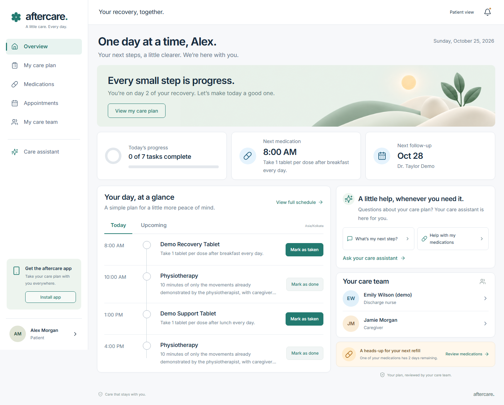

## The problem

A patient leaves hospital with instructions to remember: which medication to take, when to do their exercises, how to care for a dressing, and when to return for a review. A caregiver may be helping, but a paper discharge summary does not tell them whether today's dose has already been recorded.

After Care turns those instructions into a shared daily routine. The nurse remains responsible for the plan. AI helps organize it; patients and caregivers get a clear schedule they can open on their phones.

## From discharge note to daily care

1. **The nurse creates a discharge record.** Add the patient, an optional caregiver, discharge details, and the patient's timezone. Type instructions or use supported browser voice dictation.
2. **AI prepares a structured draft.** Medication names, prescribed doses, exact times, quantities, exercises, care tasks, and follow-ups become editable fields. Missing details are surfaced for clarification.
3. **The nurse reviews and approves.** Publication is blocked until the review checkbox is checked. Editing the draft resets approval.
4. **Each person receives their own access.** The backend creates separate patient and caregiver credentials and a shareable sign-in link, with a private access-sheet download.
5. **Recovery continues at home.** Both accounts see the same plan and recorded progress, with medication supply estimates, follow-up details, and a care assistant grounded in the reviewed instructions.

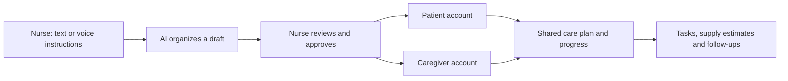

## See the experience

These screenshots come from the working application using fictional demonstration records and invented medication names. Mobile screenshots show the responsive PWA in a browser, rather than a native app-store application.

### For the discharge nurse

Search the patient roster, see today's progress and connected caregivers, and open a patient's reviewed plan.

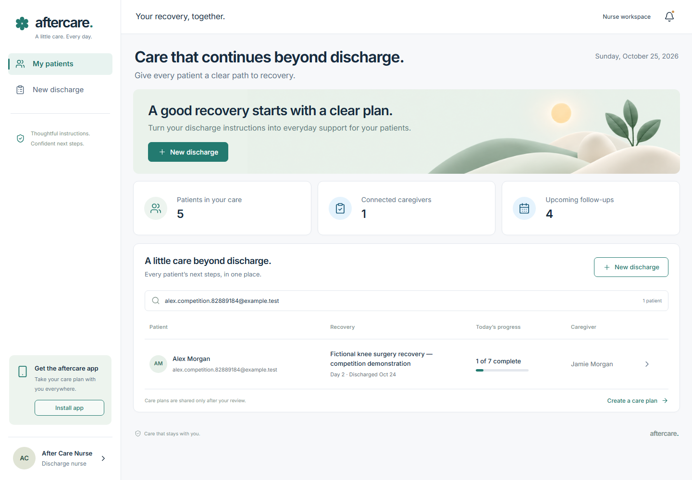

The organizer preserves the supplied schedule and flags missing information before nurse approval. Manual entry is available alongside AI.

| Patient and caregiver details | AI draft and clarification |
| --- | --- |
| 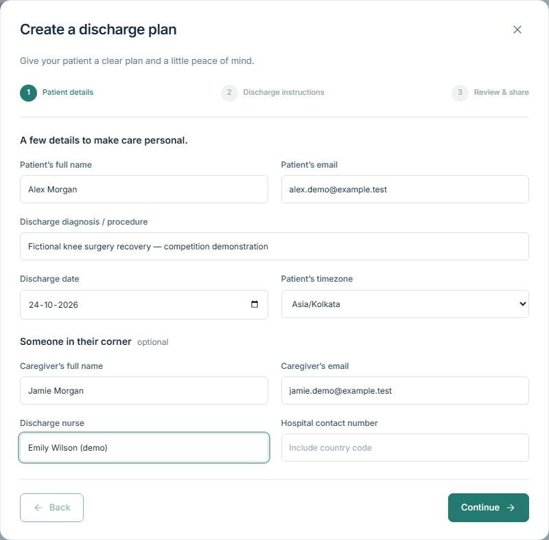 | 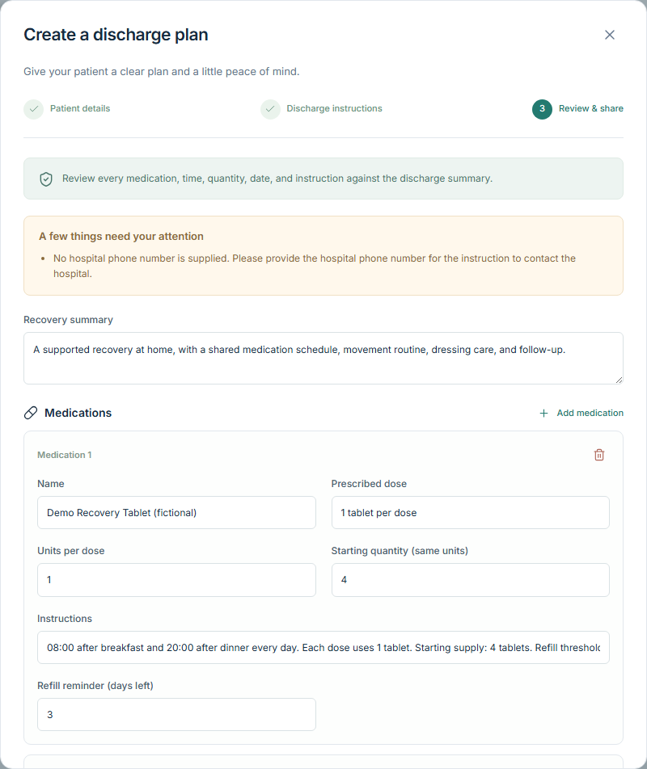 |

<details>
<summary>View the discharge instruction entry screen</summary>

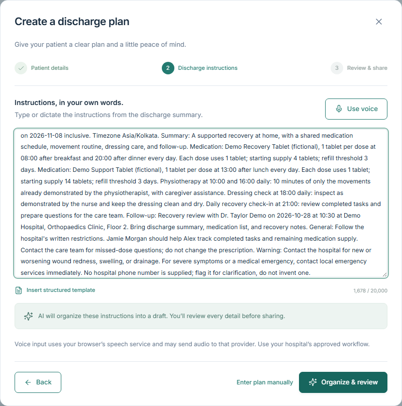

</details>

### For patients on their phones

Today's progress, medication timings, supply estimates, and follow-up details in an installable interface.

<p align="center">
  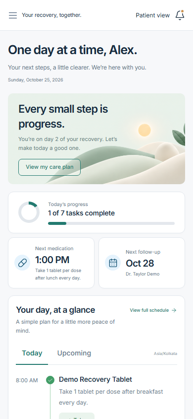
  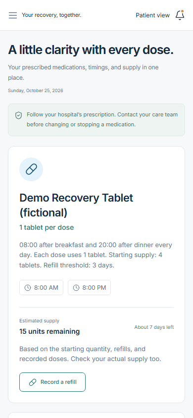
  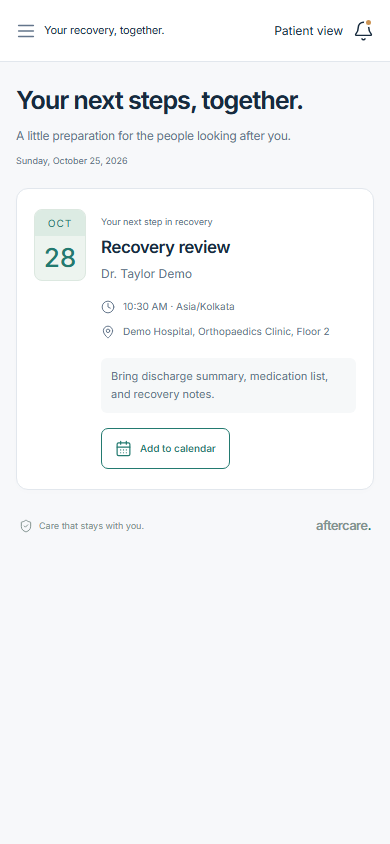
</p>

### For caregivers

Separate sign-ins, shared progress. When Alex records a dose, Jamie sees it too. Repeated submissions cannot count the same task twice. Shared views refresh every 30 seconds while visible and when the tab becomes active.

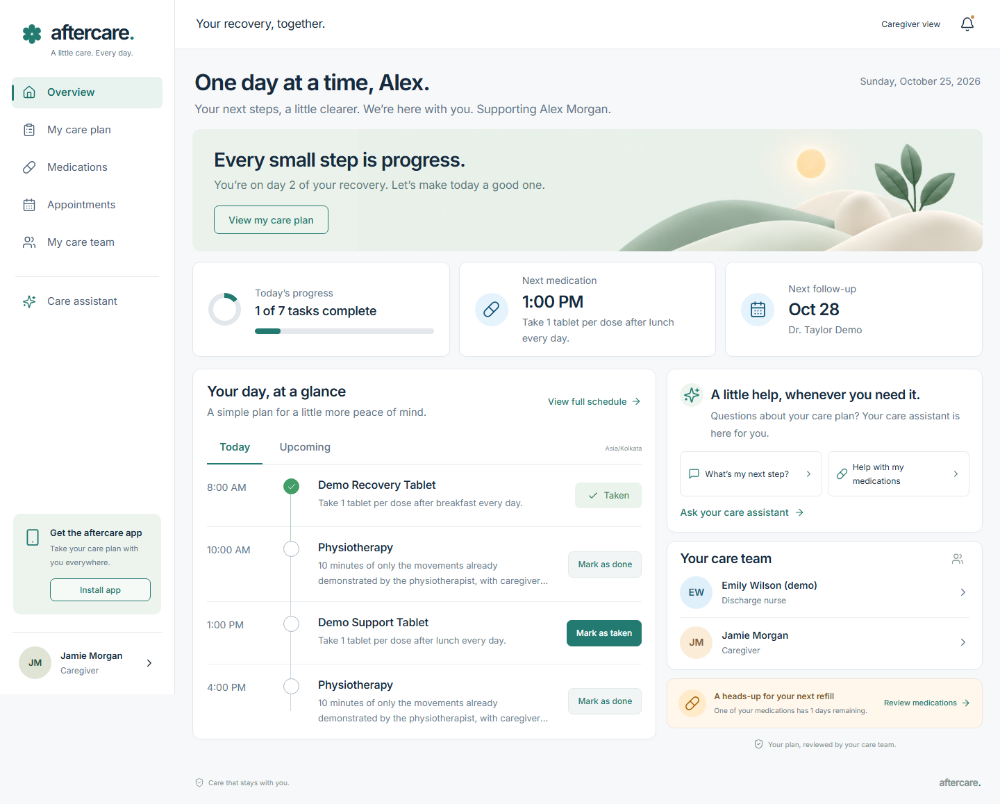

### Medication supply and follow-ups

Supply estimates use the starting quantity, recorded doses, and refills. Patients or caregivers record medication they have actually received; this updates the estimate without changing the prescribed dose. A follow-up can be downloaded as a calendar event.

| Medication supply and refill prompt | Follow-up preparation and calendar export |
| --- | --- |
| 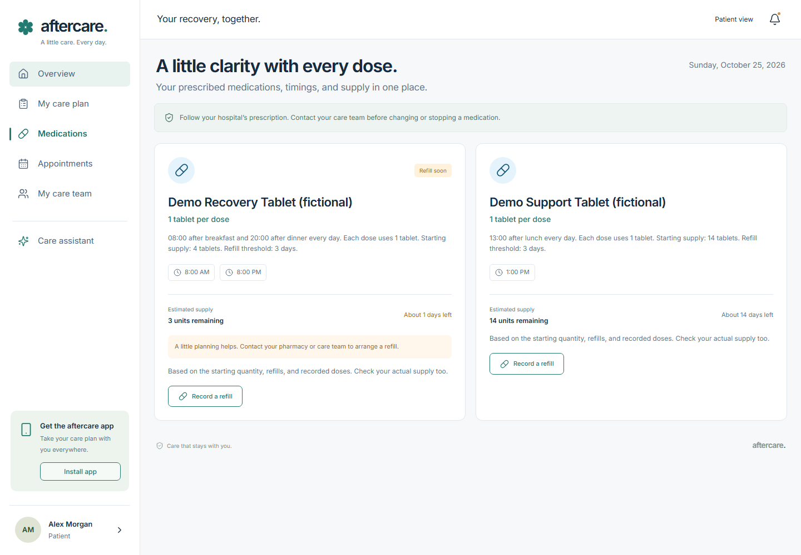 | 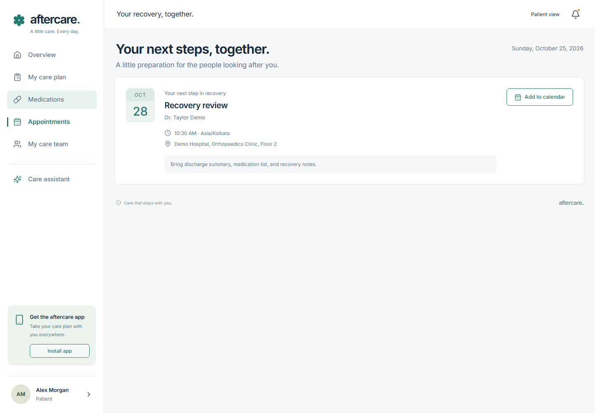 |

### A care assistant with a defined role

Patients can ask about their recorded medications, daily tasks, and next visit. The assistant uses the nurse-reviewed plan, recorded completions, and current supply estimates. It cannot change treatment, diagnose, or contact a clinician. Urgent phrases such as chest pain trigger an immediate emergency-service response before any model call.

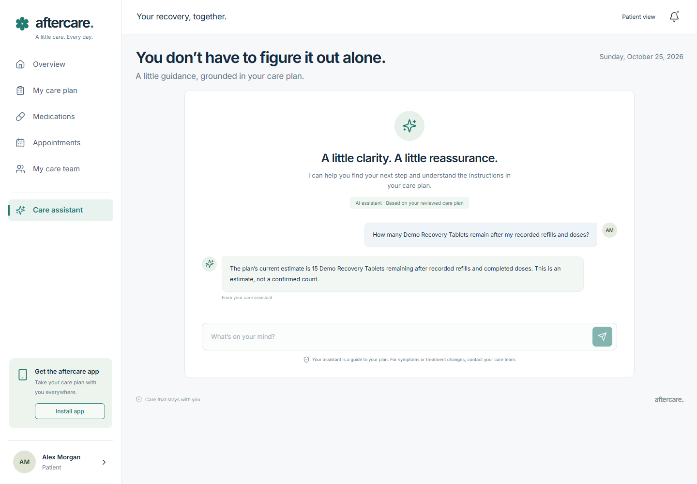

### Installation and connection loss

Add After Care to the home screen. Each patient and caregiver enables notifications on their own device. If the connection drops, the PWA shows a recovery screen; authenticated clinical data is not cached offline.

<p align="center">
  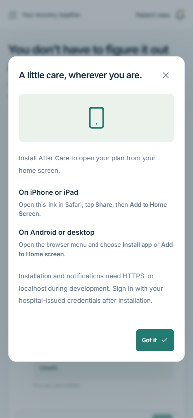
  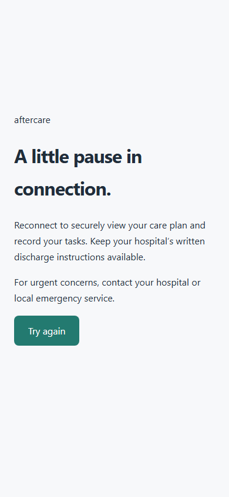
</p>

## Example use cases

| Situation | What After Care does |
| --- | --- |
| A nurse has a long discharge note | Organizes an editable draft, surfaces missing details, and requires review before publication. |
| A patient takes several daily medications | Shows exact prescribed times and asks for confirmation before recording a dose. |
| A family member helps with recovery | Provides their own account linked to the same plan and completion history. |
| Medication supply is getting low | Shows an estimate and refill prompt; a recorded refill updates shared supply. |
| Exercises and dressing care are prescribed | Includes them in the daily schedule and upcoming view. |
| A follow-up is approaching | Keeps clinician, location, preparation notes, and calendar export together. |
| A patient has no caregiver or medications | Supports a standalone account and clear empty states. |
| A patient has a question | Provides plan-grounded guidance, with a boundary for treatment questions. |
| Connectivity is lost | Shows an offline screen and retries when the connection returns. |

Background Web Push supports scheduled tasks, unchecked-task follow-ups, low-supply alerts, and same-day/next-day appointment reminders. It requires device permission, VAPID configuration, and a server scheduler every five minutes. Browser/OS delivery is not guaranteed. Live QA verified configuration and permission handling; delivered notifications and scheduler operation have not been verified.

## Try the submission

**Live:** [after-care1.vercel.app](https://after-care1.vercel.app/)

The hosted application uses hospital-issued credentials. Competition demonstration accounts are provided privately by the project owner; passwords are excluded from this repository. The owner has a local private access sheet at `.data/competition-access.txt`, alongside the existing nurse access sheet. See the [five-minute demo walkthrough](docs/demo-walkthrough.md) for the presentation path and fictional nurse instructions.

**Local evaluation without provider keys:** use Node.js 24, leave the Supabase variables unset, and run:

```sh
npm ci
npm run dev
```

Open [localhost:3000](http://localhost:3000). A labeled fictional demo lets you switch between patient, caregiver, and nurse views. Local records and hashed credentials stay in the ignored `.data/` directory. AI and real push delivery need provider configuration. The local file demo is disabled on Vercel.

For connected development, copy `.env.example` to `.env.local`, add Supabase server credentials, apply the migration to a new database, and configure OpenAI using the [setup guide](docs/development.md). The current live database already has the migration applied.

## Architecture and implementation

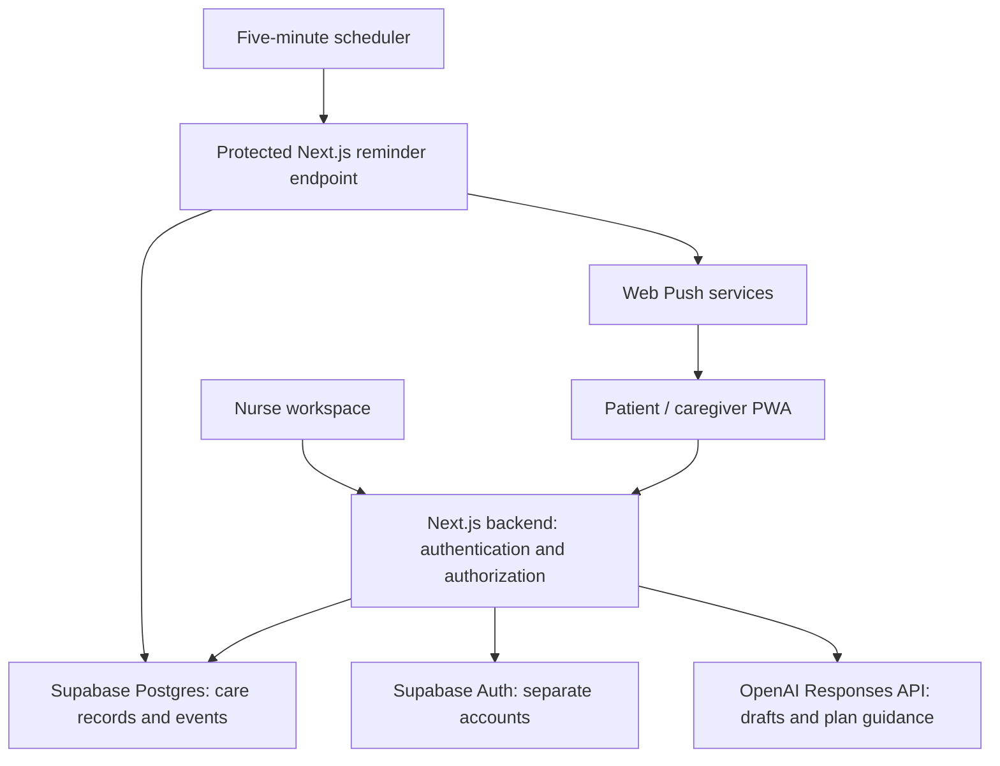

| Layer | Implementation |
| --- | --- |
| Application | Next.js 16 App Router, React 19, TypeScript, responsive CSS |
| AI | OpenAI Responses API, structured outputs, Zod validation, nurse review |
| Data and identity | Supabase Postgres and Auth through the Next.js server |
| PWA | Manifest, icons, service worker, install help, offline screen |
| Reminders | Web Push, timezone-aware windows, per-device delivery keys, claim leases |
| Hosting | Vercel, server-only secrets, deployment environment checks |
| Verification | Node/tsx unit tests and Playwright browser workflows |

**All table reads and writes go through the Next.js backend.** There is no browser Supabase client or service key. Record operations check the signed-in role and its relationship to the record. RLS is enabled and direct `anon`/`authenticated` table access is revoked. Sessions use HttpOnly cookies, with Secure cookies in production. Completion and refill writes are idempotent; patient API responses use `Cache-Control: no-store`.

AI context omits explicit account identifiers and emails. Free-text notes can still contain identifying information and are sent to the configured provider. This competition prototype makes no claim of clinical validation, regulatory certification, or demonstrated health outcomes.

## Verification

Hosted flows were exercised on **25 October 2026** at desktop **1440 × 1000** and phone **390 × 844**, using fictional records and separate browser sessions.

| Flow | Result |
| --- | --- |
| Nurse sign-in, search, AI draft, approval gate, private access download | Passed live |
| Manual creation, patient without caregiver, empty medications/appointments | Passed live |
| Patient/caregiver login, record isolation, shared completion | Passed live |
| Duplicate check-offs/refills and invalid-date rejection | Passed live |
| Refill recording, calendar export, grounded AI, urgent escalation | Passed live |
| Session renewal, sign-out, mobile navigation, offline retry | Passed live |
| Horizontal overflow, runtime errors, direct browser Supabase requests | None observed in tested flows |
| Actual device installation, voice transcription, delivered push, scheduler execution | Requires device/operator verification |

```sh
npm run typecheck
npm test
npm run build
```

The suite includes supply-estimate privacy coverage and mobile navigation regression checks. [Browser workflows](tests/workflows.spec.ts) run against a local **demo** server; the optional [connected session test](tests/connected-auth.spec.ts) checks an existing Supabase nurse. See [testing instructions](docs/development.md#checks). Never run the demo-only suite against the live hospital workspace.

## Scope and next steps

The prototype supports fixed daily schedules between inclusive start/end dates. As-needed medication decisions, tapering and alternating-day courses, prescription changes, SMS/email delivery, clinician messaging, pharmacy purchases, and clinical monitoring are outside this phase.

Next steps include device-level reminder validation, operational monitoring, audit tooling, account recovery, and a bounded reminder queue as patient volume grows. Public deployments need host-level rate limiting because the in-memory throttle is per server instance. Real clinical use requires the hospital's clinical, privacy, security, and operating approvals.

## Project guide

- [Demo walkthrough and fictional nurse instructions](docs/demo-walkthrough.md)
- [Development, Supabase setup, provisioning, and testing](docs/development.md)
- [Vercel configuration and reminder scheduling](docs/vercel-deployment.md)
- [Schema migration](supabase/migrations/202610240001_after_care.sql)
- [Complete screenshot gallery](docs/screenshots/README.md)
