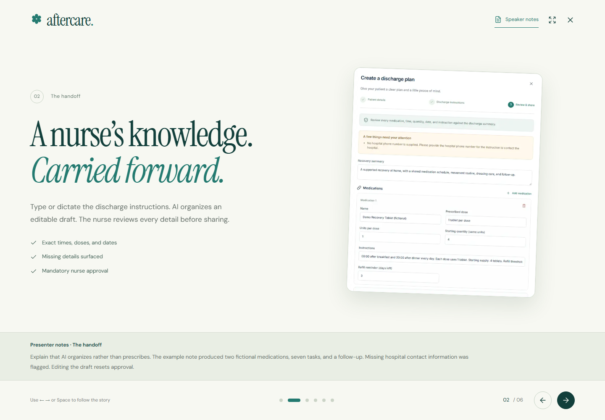

# Competition demo walkthrough

Open [After Care](https://after-care1.vercel.app/) for the public story, or [presentation mode](https://after-care1.vercel.app/present) for a six-scene pitch. The actual application is at [the care workspace](https://after-care1.vercel.app/workspace). Use private nurse credentials to sign in. Patient and caregiver credentials are in the owner's ignored `.data/competition-access.txt`; do not include this file in a public submission.

## Using presentation mode

- **← / →** and **Space** move through the story. **Home / End** jump to the first or last scene. The on-screen controls also work on a phone.
- **Speaker notes** opens a short script and the important boundaries for each scene.
- **Fullscreen** expands the deck where supported. Close the presentation to return to the landing page.
- The final scene's **Open After Care** action leads to the actual workspace. Hospital credentials remain private; slides do not expose account passwords.



## A five-minute presentation

| Time | Action | What to show |
| --- | --- | --- |
| 0:00–0:40 | Sign in as nurse; search for Alex Morgan | Roster, caregiver connection, daily progress |
| 0:40–1:40 | Open New discharge; enter fictional details and the notes below | Editable AI draft, missing-information clarification, disabled approval button |
| 1:40–2:00 | Review the draft and explain approval | Nurse-controlled publication, separate accounts, private access sheet |
| 2:00–3:00 | Open the existing Alex patient account in a separate session | Today's schedule, confirmed check-off, medication times, supply |
| 3:00–3:40 | Open Jamie's caregiver account in another session | Same plan and shared check-off; refresh or return to the tab |
| 3:40–4:20 | Open appointments and the assistant | Calendar download, a plan-grounded answer, treatment boundaries |
| 4:20–5:00 | Open on a phone or resize | Mobile dashboard, installation help, notification settings |

Use separate browsers or private windows for each account. Ordinary tabs in the same profile share a session cookie.

Existing fictional records:

- **Alex Morgan / Jamie Morgan:** AI-organized knee recovery, two invented medications, seven daily tasks, shared check-offs, refills, and a follow-up.
- **Priya Rao:** a manually entered check-in with no caregiver, medication, or appointment; demonstrates a simpler discharge.

Created on 25 October 2026. Tasks end on 8 November 2026. For later presentations, create a new fictional plan with current dates. Progress and supply change as demo participants check off tasks and record refills.

## Sample nurse notes

Use unique fictional patient and caregiver emails for a new record. Set the discharge date and timezone explicitly. This is application test data with invented medications, not a prescription. Update all dates before a later demo.

```text
Fictional competition demonstration only. Discharge date: 2026-10-25.
Timezone: Asia/Kolkata. All daily tasks start from discharge and end
on 2026-11-08 inclusive.

Summary: A supported recovery at home with a shared medication schedule,
movement routine, dressing care, and follow-up.

Medication: Demo Recovery Tablet (fictional), 1 tablet per dose at
08:00 after breakfast and 20:00 after dinner daily. Each dose uses
1 tablet. Starting supply: 4 tablets. Refill threshold: 3 days.

Medication: Demo Support Tablet (fictional), 1 tablet per dose at
13:00 after lunch daily. Each dose uses 1 tablet. Starting supply:
14 tablets. Refill threshold: 3 days.

Physiotherapy: At 10:00 and 16:00 daily, 10 minutes of only the movements
already demonstrated by the physiotherapist, with caregiver assistance.
Do not add new exercises.

Dressing check: At 18:00 daily, inspect as demonstrated by the nurse
and keep the dressing clean and dry.

Daily check-in: At 21:00, review completed tasks and prepare questions
for the care team.

Follow-up: Recovery review with Dr. Taylor Demo on 2026-10-28 at 10:30,
Demo Hospital, Orthopaedics Clinic, Floor 2. Bring the discharge summary,
medication list, and recovery notes.

General: Follow the hospital's written restrictions. The caregiver
helps track tasks and supply. Refer missed-dose questions to the care
team; do not change the prescription.

Warning: Contact the hospital for new or worsening wound redness,
swelling, or drainage. For severe symptoms or a medical emergency,
contact local emergency services immediately.

No hospital phone number is supplied. Flag it for clarification;
do not invent one.
```

Expected draft: **2 medications, 7 daily reminders, 1 follow-up**, and a missing-contact clarification. Always check the generation against the source; AI output can vary.

## Useful demonstrations

- Try publishing before review: approval is disabled. Edit a reviewed field: approval resets.
- Record a dose: both accounts see the completion without counting it twice.
- Use **Record a refill** for medication already received: stock increases without changing the prescription.
- Ask **How many Demo Recovery Tablets remain?**: the assistant should use the current estimate, including refills.
- Ask **When is my next appointment?**: the answer should match the recorded visit.
- Use the test phrase **I have chest pain**: immediate safety guidance directs the user to local emergency services.
- Open Priya's account: demonstrate the no-medication and no-appointment states.

## Device-dependent checks

Install from the browser's app menu; on iPhone/iPad use Safari → Share → Add to Home Screen. Each account enables notifications on its own device. Push requires VAPID configuration and an operational five-minute scheduler. Screenshots demonstrate the interface, not proof of OS delivery, microphone transcription, or physical-device installation.
